<div align="center">


<br>

[](LICENSE)


**[Install](#-install) · [How to use](#-how-to-use) · [Build from source](#-build-from-source) · [Architecture](#-architecture) · [Privacy](#-privacy-and-permissions) · [Roadmap](#-roadmap)**

<sub>A styled project page lives in <a href="docs/index.html"><code>docs/index.html</code></a> (GitHub README files cannot load CSS).</sub>

</div>

---

## ✨ What is Wird?

**Wird** (ورد, a daily portion of remembrance) is a browser extension that:

- 🕌 shows a **verse of the Quran or a hadith every few minutes** while you browse,
- 📖 opens a **Quran reader with search** on top of *any* web page,
- 🌍 works in **Arabic, English and French**,
- 🔒 is **offline and private**: all content ships inside the extension, no network requests, nothing collected.

One codebase builds for **Chrome, Edge, Brave and other Chromium browsers**, and for **Firefox**.

## 🎬 See it in action

<div align="center">
  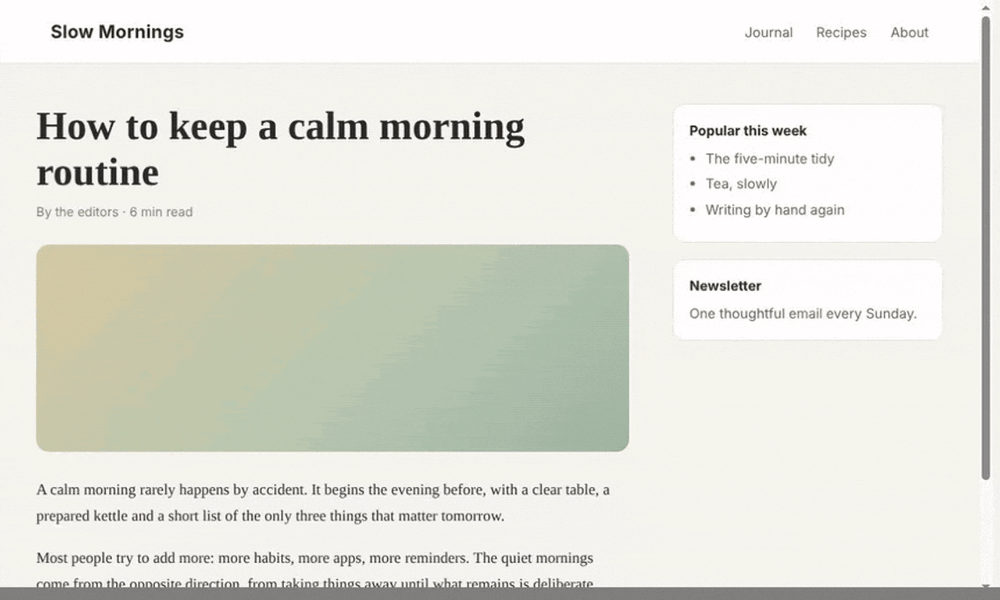
  <br><sub>A reminder card, then the reader opened with <kbd>Alt</kbd>+<kbd>Shift</kbd>+<kbd>Q</kbd>, searching for “mercy” and <code>18:1</code>.</sub>
</div>

## 🖼 Screenshots

<table>
  <tr>
    <td align="center">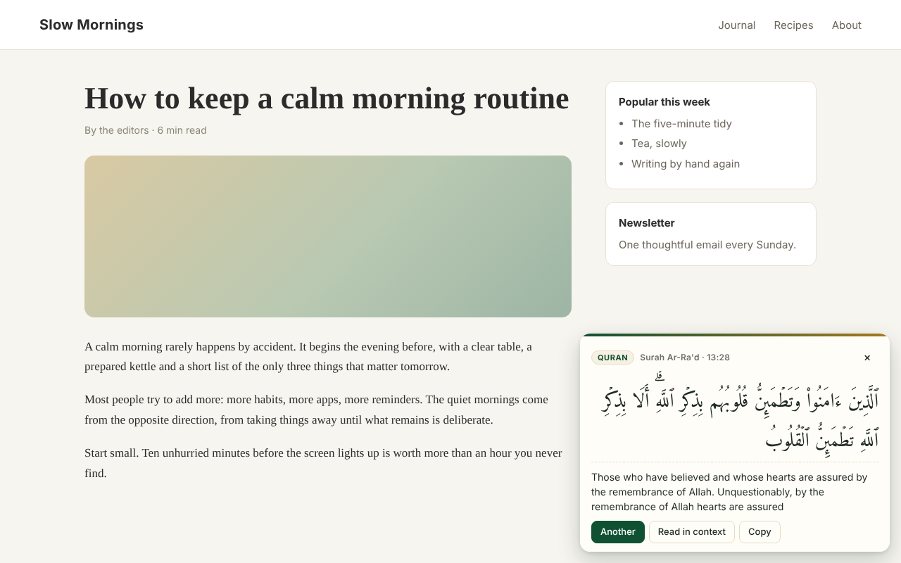<br><sub>Verse reminder on any page</sub></td>
    <td align="center">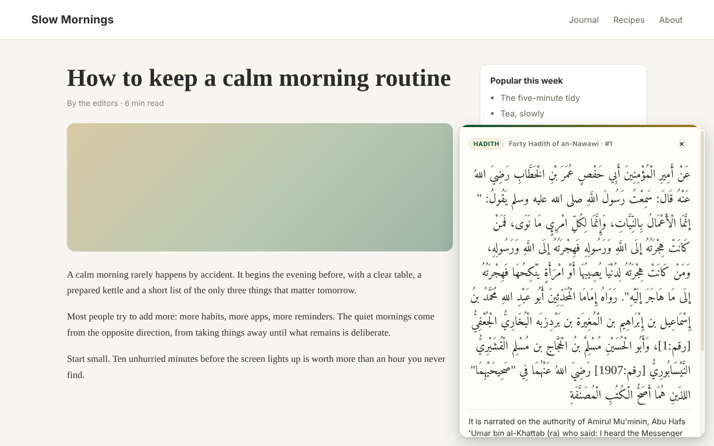<br><sub>Hadith reminder</sub></td>
  </tr>
  <tr>
    <td align="center">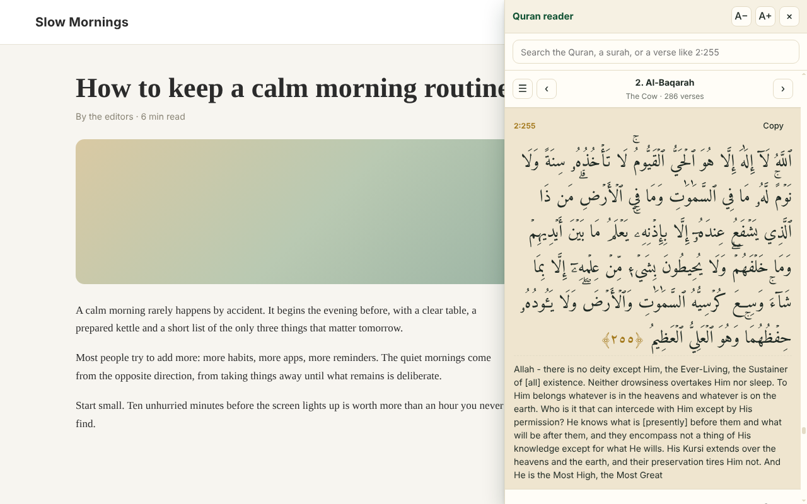<br><sub>Quran reader</sub></td>
    <td align="center">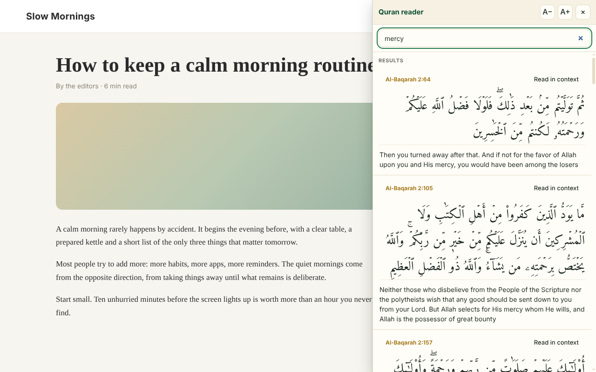<br><sub>Search across the Quran</sub></td>
  </tr>
  <tr>
    <td align="center">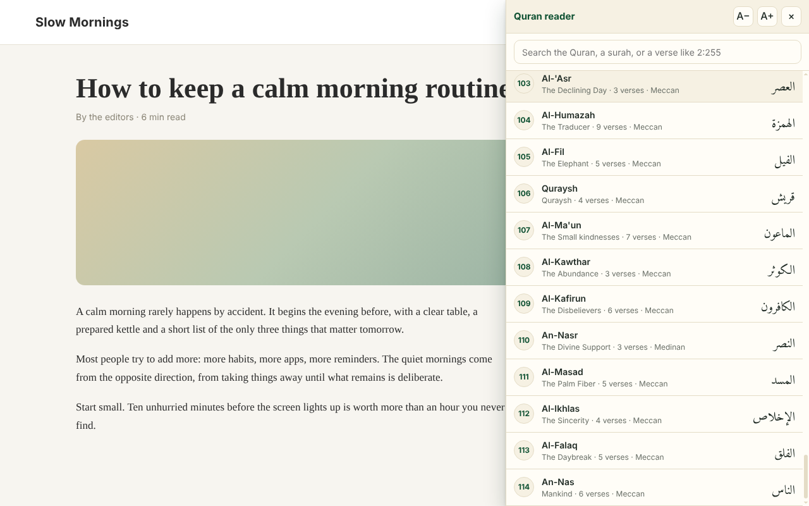<br><sub>Surah list</sub></td>
    <td align="center">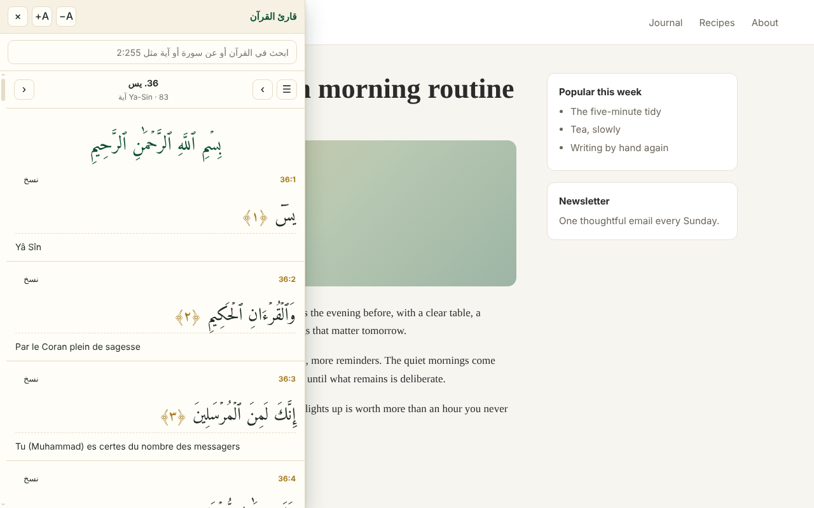<br><sub>Full Arabic (RTL) interface</sub></td>
  </tr>
  <tr>
    <td align="center">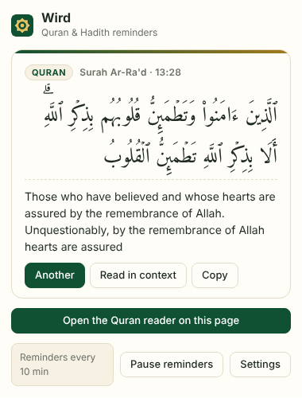<br><sub>Toolbar popup</sub></td>
    <td align="center">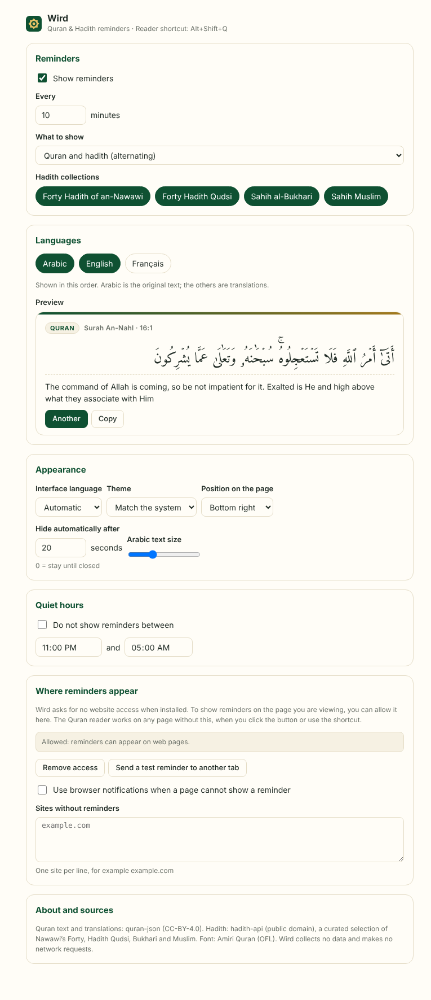<br><sub>Settings</sub></td>
  </tr>
</table>

## 🧰 Features

| | |
|---|---|
| ⏰ **Reminders** | Every N minutes (1–1440). Alternates Quran / hadith, or either alone. A shuffle bag guarantees no repeats until everything has been shown. |
| 📚 **Content** | All 6,236 verses (Arabic Uthmani + English + French). About 1,200 hadith in Arabic, English and French: Forty Hadith of an-Nawawi, Forty Hadith Qudsi, and selections from Sahih al-Bukhari and Sahih Muslim. |
| 📖 **Reader** | Opens on any page (toolbar button or <kbd>Alt</kbd>+<kbd>Shift</kbd>+<kbd>Q</kbd>). Surah list, verse-by-verse reading, previous/next surah, remembers where you stopped, adjustable text size. |
| 🔎 **Search** | Verse reference (`2:255`, `2:255-257`), surah name in any language, or full text. Arabic search ignores diacritics and matches standard spelling in the Uthmani text. |
| ⚙️ **Settings** | Interval, content type, hadith collections, languages, theme, toast position and duration, quiet hours (can wrap midnight), sites without reminders, notification fallback. |
| 🌐 **Interface** | Arabic (RTL), English, French. |

## 📥 Install

| Browser | How |
|---|---|
| Chrome Web Store | _Coming soon_ |
| Firefox Add-ons (AMO) | _Coming soon_ |
| Any (now) | Download a zip from the [Releases](../../releases) page, or [build from source](#-build-from-source). |

### Install a zip manually

<details>
<summary><b>Chrome, Edge, Brave (Chromium)</b></summary>

1. Unzip `wird-<version>-chrome.zip` into a folder you will keep (the browser reads it from there).
2. Open `chrome://extensions` (Edge: `edge://extensions`).
3. Turn on **Developer mode**.
4. Click **Load unpacked** and pick the unzipped folder (the one containing `manifest.json`).

</details>

<details>
<summary><b>Firefox</b></summary>

Temporary install (removed when Firefox closes, good for testing):

1. Open `about:debugging#/runtime/this-firefox`.
2. Click **Load Temporary Add-on…**.
3. Select `manifest.json` inside the unzipped Firefox build (or the `.zip` itself).

Permanent install requires the signed add-on from AMO.

</details>

## 🚀 How to use

1. **Install**, then the settings page opens on first run. Pick your interval, content and languages.
2. **Reminders.** A card appears on the page you are viewing. Buttons: **Another** (next one), **Read in context** (opens the reader at that verse), **Copy**.
3. **Reader.** Click the toolbar button, then *Open reader*, or press <kbd>Alt</kbd>+<kbd>Shift</kbd>+<kbd>Q</kbd> on any web page.
4. **Search.** In the reader type a reference (`2:255`, `18:1-10`), a surah name (`Kahf`, `الكهف`), or words (`mercy`, `الرحمة`).
5. **Allow reminders on pages (optional).** In settings, grant access to all sites so reminders can appear on the page itself. Without it, reminders show as a toolbar badge (the popup shows the reminder), or as a notification if you enable that.

> The shortcut can be changed in `chrome://extensions/shortcuts` (Firefox: Add-ons Manager → gear icon → *Manage Extension Shortcuts*).

## 🛠 Build from source

**Requirements:** [Node.js](https://nodejs.org) 20 or newer and npm.

```bash
git clone https://github.com/<your-user>/<your-repo>.git
cd <your-repo>
npm ci
```

### Build the extensions

| Goal | Command | Output |
|---|---|---|
| Chrome / Chromium build | `npm run build` | `.output/chrome-mv3/` |
| Firefox build (MV3) | `npm run build:firefox` | `.output/firefox-mv3/` |
| Chrome zip (store upload) | `npm run zip` | `.output/wird-<version>-chrome.zip` |
| Firefox zip + sources zip | `npm run zip:firefox` | `.output/wird-<version>-firefox.zip`, `-sources.zip` |

Then load the output folder as described in [Install a zip manually](#install-a-zip-manually).

<details>
<summary><b>Develop with hot reload</b></summary>

```bash
npm run dev            # Chrome, opens a browser with the extension loaded
npm run dev:firefox    # Firefox (MV3)
```

</details>

<details>
<summary><b>Test, type-check, lint</b></summary>

```bash
npm test               # unit tests: core logic, search, data integrity
npm run compile        # TypeScript type-check
npm run lint:firefox   # Mozilla's addons-linter on the Firefox build
npm run test:all       # everything above
```

`web-ext lint` reports 4 `innerHTML` warnings that come from inside React DOM itself; the extension's own code never uses `innerHTML`.

</details>

<details>
<summary><b>Regenerate the bundled data</b></summary>

```bash
npm run data
```

Rebuilds `public/data/*.json` from [quran-json](https://github.com/risan/quran-json) and [hadith-api](https://github.com/fawazahmed0/hadith-api). Needs network on the first run (hadith editions are cached in `.cache/hadith`). The script verifies 114 surahs / 6,236 verses and that all languages line up.

</details>

## 🏗 Architecture

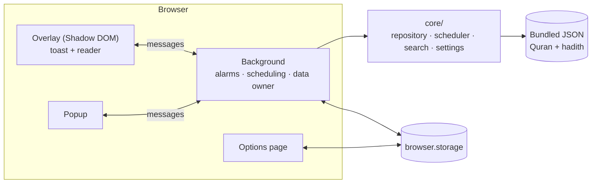

```
src/
  core/            Pure TypeScript, no browser APIs (fully unit-tested)
    repository.ts    ContentRepository: bundled JSON, search, reminder pools
    scheduler.ts     Shuffle bag with a tiny persisted cursor (seed + position)
    settings.ts      Defaults, validation and migration of stored settings
    text.ts          Arabic/Latin normalization for search
    reference.ts     "2:255" parsing and surah-name lookup
    quiet-hours.ts
  entrypoints/
    background.ts    Alarm, scheduling, delivery, message handlers
    overlay.content.tsx  Runtime-injected Shadow DOM UI (toast + reader)
    popup/, options/
  shared/            Storage, typed messaging, i18n, data loader
  ui/                React components shared by overlay, popup and options
scripts/build-data.mjs   Generates and verifies public/data/*.json
tests/                   Vitest
docs/                    Banner, screenshots, project page
```

**Design decisions**

- **One codebase, both browsers** with [WXT](https://wxt.dev). Firefox is built as MV3 (event-page background).
- **Bundled data** (about 5 MB), so it works offline with no keys or rate limits.
- **Shadow DOM** for all injected UI: site CSS cannot break it and it cannot break the site. The overlay script is injected on demand, never declared in the manifest.
- **Alarms, not timers**: survives MV3 service-worker shutdowns.
- **The Quran text is never altered.** One display-only exception: the bundled font has no glyph for U+065E (open fathatan), so it is drawn as the standard fathatan U+064B. Stored text, search and copying keep the original.

## 🔒 Privacy and permissions

Wird asks for **no website access at install** and makes **no network requests**.

| Permission | Why |
|---|---|
| `storage` | Your settings and reading position |
| `alarms` | The reminder timer |
| `activeTab`, `scripting` | Open the reader on the current page when *you* click or use the shortcut |
| `<all_urls>` *(optional)* | Show reminders on the page you are viewing. Asked only from settings. |
| `notifications` *(optional)* | Show reminders as system notifications. Asked only from settings. |

## 📜 Data sources and licenses

- Quran text and translations: [quran-json](https://github.com/risan/quran-json), CC-BY-4.0 (Arabic text from the Noble Quran Encyclopedia).
- Hadith: [fawazahmed0/hadith-api](https://github.com/fawazahmed0/hadith-api), Unlicense.
- Font: Amiri Quran, SIL Open Font License 1.1.
- Source code: [MIT](LICENSE). Details in [THIRD_PARTY_NOTICES.md](THIRD_PARTY_NOTICES.md).

Hadith are a curated subset chosen for short, self-contained content. Grading is not included; for study and rulings refer to scholars and full collections such as [sunnah.com](https://sunnah.com).

## 🗺 Roadmap

- [x] Quran + hadith reminders, reader, search
- [x] Arabic, English, French
- [x] Chrome and Firefox from one codebase
- [ ] Audio recitation
- [ ] More hadith collections and tafsir
- [ ] Store listings (Chrome Web Store, Firefox Add-ons)

## 🤝 Contributing

Issues and pull requests are welcome. Before opening a PR run `npm run test:all`. To add content (audio, tafsir, hadith), add a provider in `src/core/repository.ts` and extend `scripts/build-data.mjs`; the UI only talks to the repository through the background.

## 📄 License

[MIT](LICENSE) for the code. Bundled content keeps its own licenses (see above).
